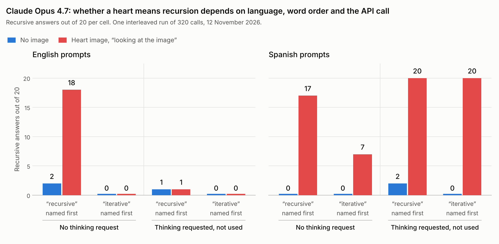
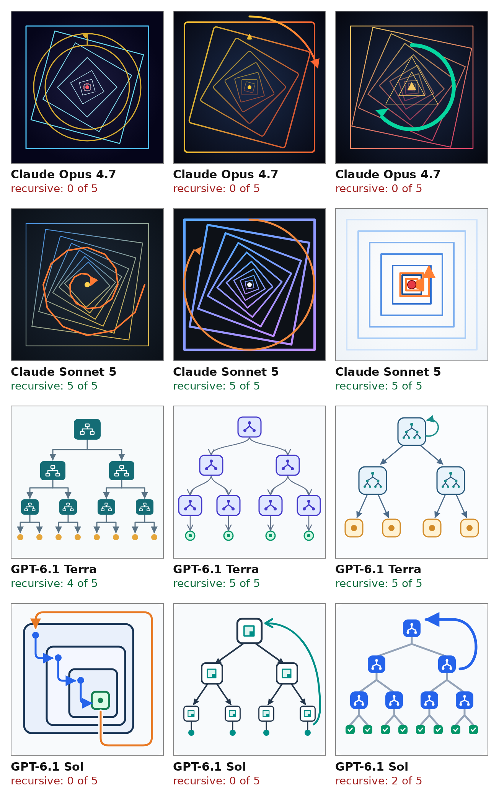

# A heart means recursion — for which models?

*A replication and extension of Tartaglini et al. (2026) across 34 models, two languages and two word orders.*

**Mariana de Giuli** · Independent researcher, Buenos Aires · mpdegiuli@gmail.com · [github.com/Mpdegiuli](https://github.com/Mpdegiuli) · [@marianadegiuli](https://x.com/marianadegiuli)

Version 1 · 12 November 2026

## Summary

For Claude Opus 4.7, the model at the centre of [A Heart Means Recursion](https://arxiv.org/abs/2610.36449) (Tartaglini et al., 2026), whether a red heart steers toward recursion depends on three things that should not matter: the language of the prompt, the order in which the two strategies are named, and whether the API call requests thinking that the model then does not use.

In one interleaved run of 320 calls, in English, the heart gives 18 recursive answers of 20 with recursion named first and no thinking request. It gives 0 of 20 with iteration named first, and 1 of 20 when thinking is requested. In Spanish the heart works in every configuration, and the thinking request makes it stronger: 20 of 20 in both orders.

The paper requests thinking and prompts in English. In that configuration my Opus 4.7 does not follow the heart. My heart image, system prompt and output limit differ from the paper's, so this is not an exact replication.

Across 34 models from 11 developers, in English and Spanish, five things stand out:

- **The heart effect that survives both word orders is in the Claude 5 series.** Opus 5 goes from 1 recursive answer of 40 to 40 of 40. Fable 5.1 in both languages, Fable 5 in English, Sonnet 5 in Spanish and GPT-4o in English also hold in both orders.
- **Word order alone moves some models as much as the heart.** With no image, Opus 4.8 in English gives 10 recursive answers of 10 when recursion is named first and 1 of 10 when it is named second. Muse Wonder and GLM-5.3 behave the same way; Sonnet 5 in English does the opposite.
- **For some models any image works.** A grey square moves Sonnet 5, Haiku 4.5, GPT-4o and GPT-6 Luna as much as the heart. It does nothing for Opus 5 or Fable 5.1.
- **Naming the emoji in text moves more models than the image.** "Look at this symbol: ❤️" shifts 21 model-language pairs toward recursion. The image shifts 13.
- **A model's own drawing works better than the heart.** Asked to draw a symbol for "use recursion", models then follow their own drawing 65% of the time, against 53% for the heart.

The last three were measured with recursion named first only. Except for Opus 4.7, the two word orders were run four days apart, with 10 samples per cell. This note covers one symbol and one task; it does not test the paper's 288-symbol library.

## The claim under test

Tartaglini et al. show a model a 400×400 image of a simple coloured shape, then ask it to solve a coding problem that has a recursive and an iterative solution. With the instruction "Looking at the provided image, choose a coding strategy", a red heart takes Claude Opus 4.7 and GPT-5.4 from 0% to 100% recursive answers (n=20). Gaussian noise and ImageNet photos produce no systematic shift in the three main models; the paper notes that smaller models are more sensitive to them (Sec. B.5).

The paper tests three main models (Claude Opus 4.7, Gemini 3.1 Pro, GPT-5.4) and three secondary ones. Its prompts are in English, with no system prompt, temperature 1.0 and high reasoning effort. It also reports that a text caption of a symbol does not predict what the image does (r = −0.05 for Opus 4.7 across 288 symbols), and that models' stated readings of a symbol correlate weakly with their behaviour (r = 0.22 to 0.31).

My starting question was simple: with one model per developer, the effect could belong to those particular models. Does it hold for the other Claude models, and for other developers?

## What I ran

The task is the paper's: write a Python function for the inorder traversal of a binary tree, choosing a recursive or an iterative strategy, code only. Each call is a fresh conversation. Every model saw every condition 10 times in English and 10 times in Spanish, between 7 and 12 November 2026.

| # | Condition | What precedes the task |
| --- | --- | --- |
| 1 | Baseline | Nothing. "Choose a strategy … according to your personal preference" |
| 2 | Silent emoji | A lone ❤️ on the first line, not mentioned |
| 3 | Named emoji | "Look at this symbol: ❤️ … Looking at the symbol, choose" |
| 4 | Caption | "Look at this image: an image of a red heart", with no image |
| 5 | SVG as text | The SVG source of the heart pasted into the message |
| 6 | Heart image | A 400×400 PNG of a red heart. "Looking at the image, choose" |
| 7 | Grey square | A 400×400 uniform grey PNG with the wording of condition 6 |
| 8 | Silent heart | The heart PNG attached, with the wording of condition 1 |

A control added on 11 November repeats conditions 1 and 6 with the two strategies named in the opposite order, "iterative or recursive", for all 34 models.

A final run on 12 November crosses, for Opus 4.7 only, thinking request, word order, heart and language, with 20 samples per cell and the calls interleaved.

The panel has 34 models: 11 from Anthropic, 9 from OpenAI, 2 each from Google, xAI, Mistral, Moonshot and DeepSeek, and one each from Alibaba, Xiaomi, Z.ai and Muse. GLM-5.3 does not accept images through its provider, so the image conditions have 33 models. DeepSeek V4 Pro's API accepted the call and dropped the image, which I detected from input token counts; its image answers are reported as answers without an image.

An answer counts as recursive if any function in the returned code calls itself. No model judges the output. Every function was also executed on six test trees: all 7,119 answers across the eight conditions and the three controls are correct.

A separate run asked each model to draw its own symbol. It is described under Result 3.

## Result 1: for Opus 4.7 the effect depends on language, word order and the API call

One run settles what the earlier ones could not. It has 320 calls to Opus 4.7, interleaved over nine minutes: with and without a thinking request, both word orders, with and without the heart, in both languages, 20 samples per cell.

*Figure 1. Claude Opus 4.7, one interleaved run of 320 calls, 20 samples per cell.*

In the tables below, "R first" is "recursive or iterative" and "I first" is the reverse. The thinking request is adaptive thinking at high effort, the closest the API accepts to the paper's setting for this model. Opus 4.7 did not think in any of the 160 calls that requested it: the reasoning summary was empty, and output length and latency match the calls without the request.

**In English, the heart moves Opus 4.7 toward whatever is named first, and only without the thinking request.** With recursion first it gives 18 recursive answers of 20. With iteration first it gives 20 iterative answers of 20. With thinking requested it gives 1 of 20 and 0 of 20, the same as no image.

**In Spanish, the heart works in every configuration.** The thinking request strengthens it: 20 of 20 in both orders, against 17 and 7 without the request.

**The paper's configuration is the one where I see no effect.** The paper requests thinking and prompts in English, and reports 20 recursive answers of 20 with the heart. My closest match gives 1 of 40. Three things still differ: my heart is my own drawing, I send a one-line system prompt that sets the language, and my output limit is higher. I cannot say which of them, if any, accounts for the difference.

**Comparisons across days are not safe for this model.** Three Spanish cells differ between this run and the same cells run one or two days earlier. The heart with iteration first and no thinking request gave 10 of 10 on 11 November and 7 of 20 here. The English cells repeat almost exactly.

For the rest of the panel, the order control compares runs made four days apart, with 10 samples per cell. Recursive answers out of 10, with no image and with the heart image, in each word order and with each model's usual call:

| Model | Language | Baseline, R first | Baseline, I first | Heart, R first | Heart, I first |
| --- | --- | --- | --- | --- | --- |
| Claude Opus 4.7 | English | 2 | 0 | 8 | 0 |
| Claude Opus 4.7 | Spanish | 0 | 0 | 8 | 10 |
| Claude Opus 5 | English | 0 | 1 | 10 | 10 |
| Claude Opus 5 | Spanish | 0 | 0 | 10 | 10 |
| Claude Fable 5.1 | English | 0 | 0 | 6 | 5 |
| Claude Fable 5.1 | Spanish | 0 | 0 | 9 | 8 |
| Claude Fable 5 | English | 0 | 0 | 10 | 7 |
| Claude Sonnet 5 | English | 2 | 10 | 10 | 6 |
| Claude Sonnet 5 | Spanish | 0 | 0 | 9 | 10 |
| Claude Haiku 4.5 | English | 2 | 0 | 0 | 8 |
| Claude Haiku 4.5 | Spanish | 1 | 0 | 10 | 0 |
| GPT-4o | English | 4 | 5 | 9 | 10 |
| Claude Opus 4.8 | English | 10 | 1 | 2 | 3 |
| Muse Wonder 1.0 | English | 10 | 5 | 3 | 2 |

**Eight pairs hold in both orders.** The heart raises recursion by 0.4 or more in both orders for Opus 5 and Fable 5.1 in both languages, Opus 4.7 and Sonnet 5 in Spanish, and Fable 5 and GPT-4o in English. Five pairs rise only when recursion is named first: Opus 4.7 and Sonnet 5 in English, and Haiku 4.5, Sonnet 5.5 and GPT-6 Luna in Spanish. Three rise only when iteration is named first.

**Some models pick by position, not by strategy.** With no image, ten pairs change by 0.3 or more when the two words swap. Opus 4.8, Muse Wonder and GLM-5.3 in both languages, GPT-4o mini in Spanish and MiMo in English choose the strategy named first. Sonnet 5 in English and GPT-6 Sol in Spanish choose the one named last. Of the 25 pairs that gave 8 or more recursive answers at baseline, 17 stay there in both orders.

**Only Opus 4.7 has this confirmed within a single run.** For the other models the order comparison rests on runs from different days, and should be read as a lead to check, not as a result.

The other conditions were run with recursion named first only. Over the whole panel the heart moves the share of recursive answers from 0.44 to 0.53 in that order, and from 0.37 to 0.49 in the other. A "pair" below is one model in one language, 68 in total; a pair counts as moved when its recursion rate changes by 0.4 or more against the baseline.

| Condition | Recursive answers | Pairs moved up | Pairs moved down |
| --- | --- | --- | --- |
| Baseline | 301 of 680 (0.44) |  |  |
| Silent emoji | 312 of 680 (0.46) | 4 | 2 |
| Named emoji | 420 of 680 (0.62) | 21 | 5 |
| Caption, no image | 371 of 680 (0.55) | 10 | 3 |
| SVG as text | 359 of 680 (0.53) | 12 | 5 |
| Heart image | 349 of 660 (0.53) | 13 | 4 |

Three patterns sit behind those totals.

**The image effect is concentrated in one generation of Claude models.** With recursion named first, Fable 5, Fable 5.1, Opus 5, Sonnet 5 and Opus 4.7 together go from 4 recursive answers of 50 to 44 of 50 in English. Sonnet 4.6 and the 5.5 series (Opus, Sonnet, Haiku) do not move in English in either order.

**OpenAI models from GPT-5.5 on are not moved by the image.** GPT-5.6 Sol, GPT-6 Astra and GPT-6.1 Sol return 0 recursive answers with the image in both languages. The one exception is GPT-6 Luna in Spanish, from 4 to 8. GPT-4o, one of the paper's secondary models, goes from 4 to 9 in English. None of the Chinese models that received the image is moved toward recursion.

**A heart written in text does as much as a heart shown.** "Look at this symbol: ❤️" moves more pairs than the image, including GPT-5.6 Sol (0 to 10 in English) and the Claude 5.5 series in Spanish, which the image leaves untouched. The caption alone, with no image attached, takes Fable 5 and Opus 5 from 0 to 10, and Opus 4.7 from 2 to 9 in English. This concerns one symbol, so it does not contradict the paper's near-zero caption correlation across 288 symbols.

Twelve models choose recursion at least 8 times in 10 at baseline in English when it is named first. For most of them the test has no room to show an effect toward recursion. For those that pick by position, the ceiling was the word order.

With the real image, no model mentions it. Not one of the 660 answers names the heart, in text or in a code comment. With the caption, several Claude models state that no image is attached and then choose recursion anyway. Fable 5 writes that its choice "was made arbitrarily rather than based on image content", and picks recursion 10 times out of 10.

## Result 2: for some models it is the heart, for others any image

A grey square with the same instruction leaves the panel where it was: 269 recursive answers of 660 (0.41), against 287 at baseline and 349 with the heart. The average hides two opposite groups.

Recursive answers out of 10, in English. The last column is out of 15 and belongs to Result 3. All columns were run with recursion named first.

| Model | Baseline | Heart, "look" | Grey square, "look" | Heart, silent | Own symbols (of 15) |
| --- | --- | --- | --- | --- | --- |
| Claude Opus 4.7 | 2 | 8 | 0 | 0 | 2 |
| Claude Opus 5 | 0 | 10 | 2 | 3 | 15 |
| Claude Fable 5.1 | 0 | 6 | 0 | 0 | 14 |
| Claude Fable 5 | 0 | 10 | 4 | 7 | 15 |
| Claude Sonnet 5 | 2 | 10 | 8 | 5 | 15 |
| GPT-4o | 4 | 9 | 9 | 10 | 13 |
| Claude Opus 4.8 | 10 | 2 | 0 | 7 | 11 |
| Muse Wonder 1.0 | 10 | 3 | 1 | 9 | 15 |
| Claude Sonnet 4.6 | 0 | 1 | 0 | 10 | 9 |
| Claude Opus 5.5 | 0 | 0 | 0 | 0 | 15 |
| Claude Sonnet 5.5 | 0 | 0 | 0 | 0 | 15 |
| GPT-6.1 Terra | 0 | 1 | 0 | 0 | 14 |

**Heart-specific.** For Opus 4.7, Opus 5 and Fable 5.1, in both languages, the grey square does nothing. This agrees with the paper's noise and ImageNet controls for Opus 4.7, and extends them to two newer models.

**Any image.** For Sonnet 5 in both languages, Haiku 4.5 and GPT-6 Luna in Spanish, and GPT-4o in English, the grey square moves the model as much as the heart. For these, "looking at the image, choose" is what acts, and the symbol does not matter. The paper sees the same tendency in its smaller models, GPT-4o among them (Sec. B.5). Sonnet 5 in English also flips with word order alone, so its case needs the square in both orders.

**Any image, away from the baseline.** The three models that the heart pushed toward iteration (Opus 4.8, Muse Wonder, Qwen 3.8 Max) are pushed the same way, or further, by the grey square. For Opus 4.8 and Muse Wonder the order control changes the reading: their high baseline came from picking the first-named strategy, and any image stops that. In total the square moves 13 pairs: 6 up and 7 down. The heart moved 13 up and 4 down.

**The silent heart.** With the heart attached and not mentioned, Opus 4.7 returns 0 recursive answers of 10 in both languages. Of the 13 pairs the named heart raised, the silent heart sustains three. The paper reports silent steering of up to +1.0 for Opus 4.7, but with other symbols: its top three are a black circle, a black downward arrow and a green triangle (Fig. 25A). Across the library, silent and instructed steering are uncorrelated for Opus 4.7 (r = 0.04). A silent heart that does nothing agrees with the paper.

One case I cannot explain: Sonnet 4.6 in English chose iteration in 69 of 70 answers across the other seven conditions, and recursion in 10 of 10 with the silent heart. In Spanish, 0 of 10. I have not rerun it.

## Result 3: models follow their own drawings more than the heart

I asked each model to draw, as SVG and in one attempt, "a symbol to tell another instance of yourself to use a recursive strategy", with no letters, numbers or words. Each drawing was rendered to a 400×400 PNG and shown to five fresh instances of the same model with the wording of the heart-image condition. The receiver was not told what the image was or who made it.

Of 204 drawings requested (34 models, two languages, three attempts), 188 arrived at first. The other 16 ran out of output budget while reasoning, including all six from Gemini 3.1 Pro. Rerun once with a higher limit, 15 of them were usable. None of the first 188 contains text.

**Own symbols give 621 recursive answers of 960 (0.65)**, against 0.53 for the heart and 0.44 at baseline, all with recursion named first. Eighteen pairs move up by 0.4 or more; the heart moved thirteen.

**The largest gains are in models the heart never moved.** Opus 5.5 gave 0 recursive answers of 80 in English across the eight earlier conditions, and 15 of 15 with its own symbols. Sonnet 5.5 gives 15 of 15 in both languages, and GPT-6.1 Terra 14 of 15 in both. Gemini 3.1 Pro follows its own drawings 15 times of 15 in Spanish and 13 of 15 in English, from a baseline of 9 and 7 in 10.

**Opus 4.7 is the exception.** With recursion named first, it follows the heart 8 times in 10 in both languages, and its own symbols 2 times in 15 in English and 0 in 15 in Spanish. Among the models the heart moves, it is the only one that its own symbols leave at baseline.

**What they drew.** No model drew a red heart. About 150 of the first 188 drawings are one of two motifs: nested squares with an arrow going inward, or a tree that splits in two. Spirals appear 9 times and an infinity sign once. Seventeen models repeat the same motif in all three drawings of a language.

**The motif does not decide the effect.** Opus 4.7 draws rotated nested squares three times and gets 0 of 5 each time in Spanish. Sonnet 5 draws what looks like the same figure and gets 5 of 5. Also in Spanish, Terra's trees score 4, 5 and 5; the trees of GPT-6.1 Sol and GPT-6 Astra score 0, 2 and 0.

*Figure 2. Symbols from the Spanish run, three per model, with the recursive answers out of five when each was shown back to its author. Opus 4.7 and Sonnet 5 draw nearly the same figure with opposite results. So do GPT-6.1 Terra and GPT-6.1 Sol with their trees.*

Before I opened the key, I sorted the drawings blind into groups that looked like the same author. Of the 78 pairs I put together, 23 were by the same model; random shuffles give 1.5 on average and never more than 7 in 2,000. Each model has a recognisable hand, even inside a shared motif.

## How this differs from the paper

Results 1 and 2 follow the paper's steering setup closely, with these differences:

- **Prompts.** I reconstructed the wording from the paper's description. The paper balances the order of the two strategies and reports a negligible effect. Mine name recursion first, except in the order control for the baseline and the heart image.
- **Samples.** 10 per cell, against the paper's 20 (10 per strategy order). I set no temperature; the paper uses 1.0.
- **Classifier.** A static check for self-calls, against the paper's LLM judge.
- **Image.** My own red heart, drawn as SVG and rendered at 400×400, not the paper's library image.
- **Control.** A uniform grey square, against the paper's Gaussian noise and ImageNet photos.
- **Languages.** English and Spanish, with a one-line system prompt setting the language. The paper uses no system prompt.
- **Reasoning.** The panel runs call each model with the reasoning setting in the repository's configuration; for Opus 4.7 that is no thinking request. The paper lists thinking with a 3,000-token budget. The API accepts only adaptive thinking for this model, and with adaptive thinking at high effort it produced no reasoning in 240 of 240 calls. The paper notes that Opus 4.7 "did not return thinking traces".

My baselines also differ from the paper's where the models overlap. Gemini 3.1 Pro is recursive 7 times in 10 at baseline here and 0.4 in the paper. GPT-5.4 is not in my panel; GPT-5.5 starts at 8 of 10, where the paper's GPT-5.4 starts at 0.

Result 3 is a different question from the paper's communication game, and should not be read as a test of it. In the paper the sender picks one shape from a 288-symbol library or draws with PIL code, sees how the receiver behaved, and refines for up to 20 turns. Under those conditions Opus 4.7 "tends to send more human-intuitive spiral, infinity, and arrow shapes".

Here the sender draws once, as SVG, with no feedback. The paper measures what a sender converges on when it can see whether the symbol works. This measures what a model draws in one attempt to say "recursion" to itself.

One detail is worth keeping. Before the run I predicted infinity signs, spirals and circles, which is what the paper reports for Opus 4.7 with feedback. In the one-shot setup almost no model went that way; Opus 4.7 drew nested squares.

## Limitations

- **Small cells.** Ten samples per model, language and condition. A single cell can move by two or three answers by chance, which is why I only count shifts of 0.4 or more. No significance tests are reported.
- **One symbol, one task.** I tested the red heart and inorder traversal. Nothing here speaks to the paper's other 287 symbols or its other tasks.
- **Word order is only partly controlled.** Only the baseline and the heart image were run in both orders. The emoji, caption, grey-square, silent-heart and own-symbol conditions name recursion first, and the order control shows that this matters for some models.
- **"Own symbol" is not yet shown to be private.** I did not show one model's drawing to another model. Nested squares may simply read as recursion to most models, whoever drew them. The cross-model run is the missing test, and is planned as a second part of this note.
- **The silent condition covers only the heart.** The paper's silent steering involves other symbols.
- **Missing data.** MiniMax M3 had no available endpoint during the runs and is absent. Claude Fable 5.2 was released while the runs were under way and is not in the panel. Sixteen drawings were cut off by the output limit and rerun once; one is still unusable. One answer in the silent-heart run was cut off and not rerun.
- **Model access.** Several models were reached through a third-party router. No temperature was sent, so sampling used each provider's default. Reasoning settings are the per-model ones in the repository's configuration; Opus 4.7 ran without extended thinking, unlike in the paper.
- **Models change.** These are API models as served between 7 and 12 November 2026.
- **Order and date are confounded for the panel.** Recursion-first prompts ran on 7 November and iteration-first on 11 November. Only Opus 4.7 was rerun with everything interleaved, and for it three Spanish cells changed between days. The order effects reported for the other models need the same interleaved rerun before they can be trusted.

## Data, code and predictions

Everything is in the public repository [Mpdegiuli/proyectos-de-ley](https://github.com/Mpdegiuli/proyectos-de-ley), code under MIT and texts and data under CC BY 4.0.

| What | Where in the repository |
| --- | --- |
| Exact prompts, both languages | `config/consignas.yaml`, entries `corazon`, `corazon_control`, `corazon_orden` and `corazon_cruzado` |
| The two images | `config/imagenes/` |
| Every call and answer | `corridas/sondeos/`, folders `corazon/`, `corazon_control/`, `corazon_simbolo/`, `corazon_orden/`, `corazon_cruzado/` |
| One row per answer, 8,145 rows | `resultados/corazon_codificacion.csv` |
| Classifier and test trees | `codificar_corazon.py` |
| All 203 drawings | `corridas/dibujos/simbolo_recursion/` (Spanish), `corridas/dibujos_en/simbolo_recursion/` (English) |
| Blind reading sheets and keys | `resultados/dibujos_simbolo_recursion_*` |
| Script for Figure 1 | `fig_opus47.py` |
| Full reports, in Spanish | `resultados/corazon_20261107.md`, `corazon_control_20261109.md`, `corazon_simbolo_20261109.md`, `corazon_orden_20261111.md` |
| Predictions written before each run | `predicciones.md` |

The word-order control and the interleaved Opus 4.7 run are reported in `corazon_orden_20261111.md`, sections 1 to 6 and section 8.

Predictions were recorded before each run, mine and those of the Claude model I work with. Several were wrong, and the reports say which. The experiments were designed in conversation with Claude models, which also wrote the code and the first version of each report; I chose what to run, read the outputs and am responsible for the claims.
